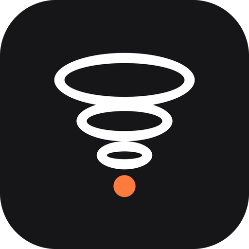
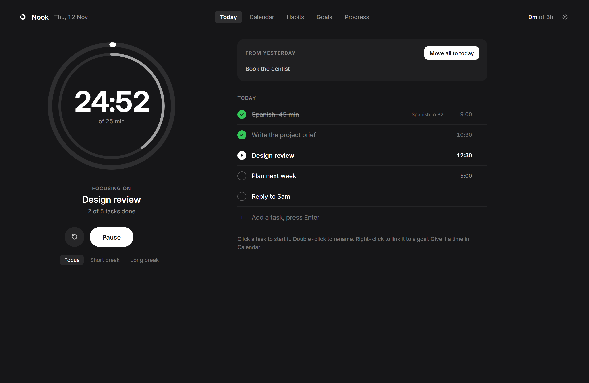
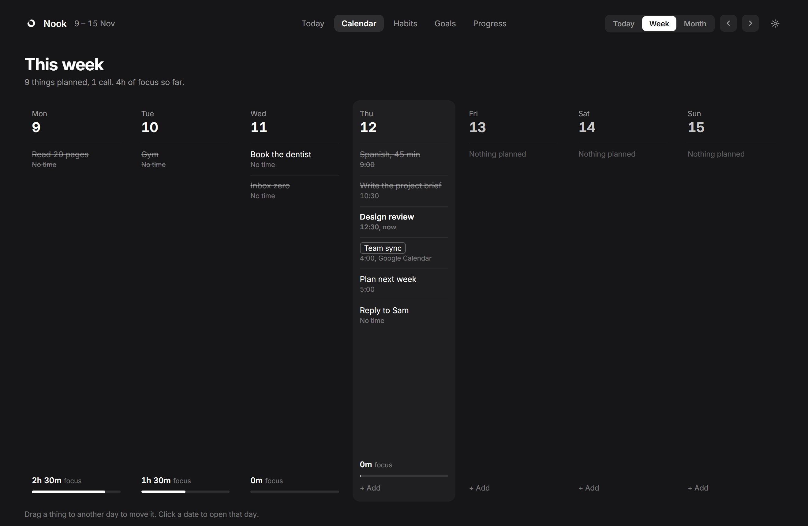
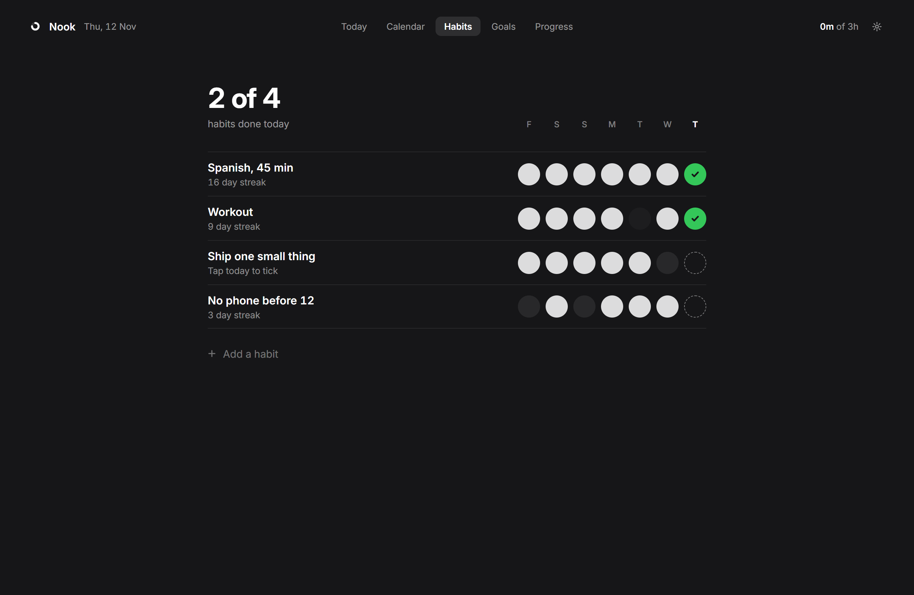
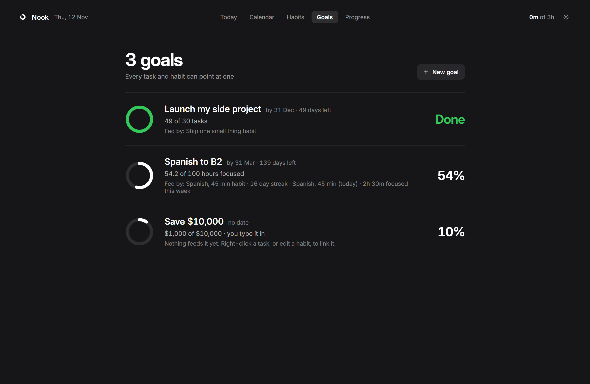
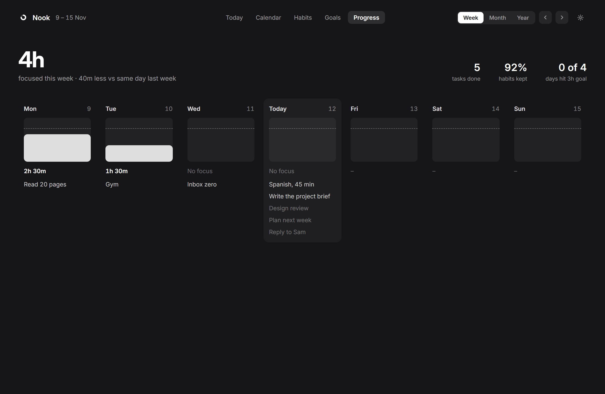

<div align="center">



# Nook

**Focus & Productivity Tool for Windows**

A quiet place to plan your day, focus on one thing, and see where your time really went.

[](https://github.com/Liyan-Shanvel/Nook/releases/latest)
[](#install)
[](LICENSE)



</div>

## Why Nook

Most to-do apps show you everything at once. Nook shows you today.

You pick a task, press start, and the big ring counts down. Everything else waits. When the time is up, a soft sound tells you to take a break. At the end of the day you can see what you actually did, not just what you planned.

It is free, it has no ads, and your tasks stay on your own computer.

## What you get

| | |
|---|---|
| **Focus timer** | One big ring. Scroll on it to change the time, or click the time and type it. Each task can have its own length. |
| **Today** | Your tasks for the day, in order. Anything left from yesterday waits in one box until you move it. |
| **Taskbar timer** | A small timer sits on your Windows taskbar, so you can see your time without opening the app. |
| **Calendar** | Day, week and month. Drag a task to another day. Your Google Calendar meetings show up next to your tasks (read only). |
| **Habits** | Tick them off each day and see your streak over the last 12 weeks. |
| **Goals** | Say what moves a goal (focus time, tasks, calendar, calls, a number) and Nook counts it. |
| **Vision** | A board of pictures and words for what you are working for. |
| **Progress** | How much you focused this week, month and year, tasks done and habits kept. |
| **Time tracking** | Nook can note which app is in front while you work, so the day view shows where your time really went. Turn it off in Settings. |
| **Soft sounds** | Pick a calm tone for when focus ends, when a break ends, and when you finish a task. |
| **Updates itself** | When a new version is out, one click restarts Nook on it. No reinstall. |

<table>
  <tr>
    <td></td>
    <td></td>
  </tr>
  <tr>
    <td></td>
    <td></td>
  </tr>
</table>

## Install

1. Download **`Nook-Setup-x.y.z.exe`** from the [latest release](https://github.com/Liyan-Shanvel/Nook/releases/latest).
2. Run it. No admin rights needed.
3. Sign in with Google to see your calendar, or click **Use without an account**.

> **"Windows protected your PC"?** Nook is new and not code-signed yet. Click **More info**, then **Run anyway**.
>
> **"Google hasn't verified this app"?** Nook only reads your calendar. Click **Advanced**, then **Go to Nook**.

## Your data

- Tasks, habits, goals and history live in one file on your PC: `%LOCALAPPDATA%\FocusOS\focusos.db`.
- Nook has no server. Nothing is uploaded.
- Google access is read only, and only for your calendar. Sign out in Settings at any time.
- The app tracker notes which app is in front while you work. That data never leaves your PC.

## Build from source

Needs Python 3.13 and [Inno Setup 6](https://jrsoftware.org/isinfo.php).

```powershell
pip install pywebview pystray pillow pytest pyinstaller google-auth-oauthlib
py -m pytest -q tests          # run the tests
py app.py                      # run Nook without installing
powershell -File build\build.ps1   # build dist\Nook-Setup-<version>.exe
```

Google sign-in needs your own OAuth desktop client saved as `google_client.json` in the project folder. It is never committed.

Project layout:

```
app.py          window, tray, background jobs
store.py        all data (one SQLite file)
bar.py          the taskbar timer
account.py      Google sign-in and calendar sync
tracker.py      which app is in front
updater.py      self-update from GitHub Releases
ui/             the screens (HTML, CSS, JS)
sounds/         notification tones (CC0)
build/          PyInstaller + Inno Setup scripts
tests/          pytest suite
```

## Contributing

Bug reports and ideas are welcome. Please read [CONTRIBUTING.md](CONTRIBUTING.md) first.

## License

Nook is **free for personal and noncommercial use** under the [PolyForm Noncommercial License 1.0.0](LICENSE).

You can use it, share it, study the code and change it. You can't sell it or use it to make money. For commercial use, open an issue to ask.

Sounds are from [Notifications](https://github.com/akx/Notifications) by Aarni Koskela (CC0). The font is Inter (SIL Open Font License). See [sounds/CREDITS.md](sounds/CREDITS.md).
